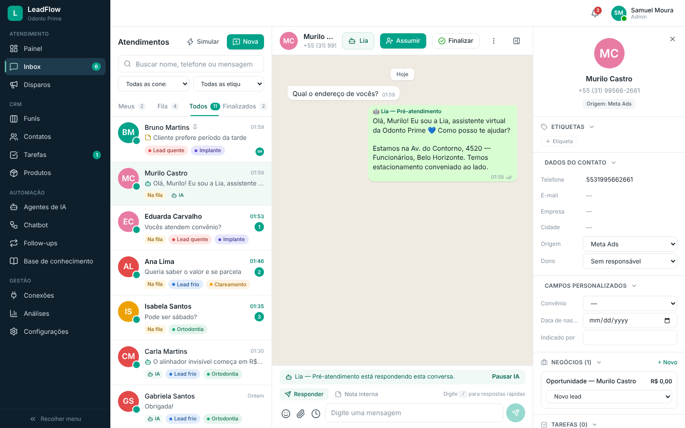
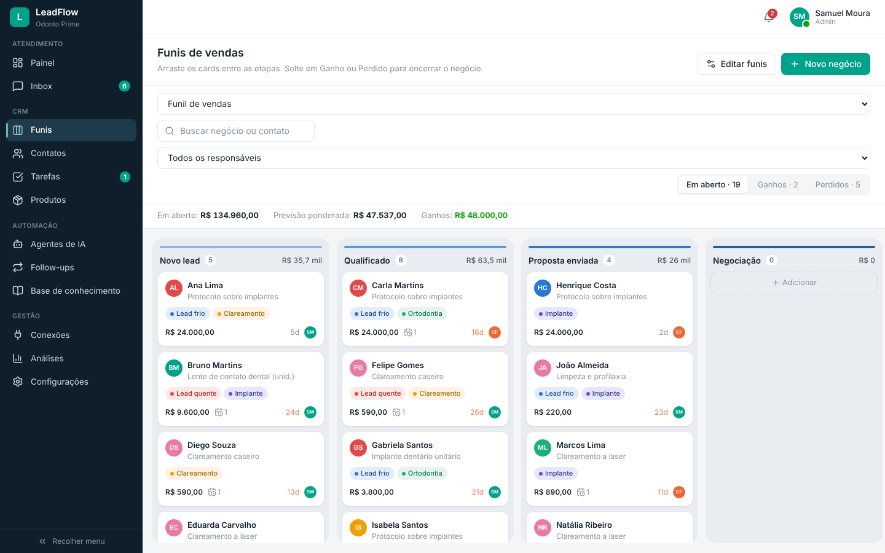
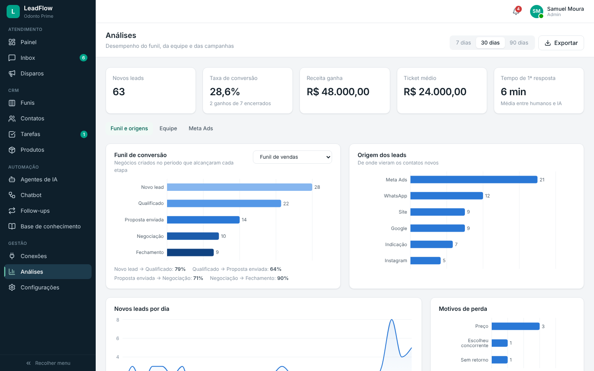

# LeadFlow CRM — CRM de WhatsApp com Agentes de IA

CRM para **gerir leads em atendimento pelo WhatsApp**: inbox compartilhada, funil de vendas (Kanban), chatbot de menu, agentes de IA, follow-ups automáticos, disparos e análises.

Projeto construído a partir do material _“Instale seu próprio CRM de WhatsApp com Agentes de IA”_: roda numa **VPS**, usa o **Supabase** como banco e fica num **domínio próprio** com HTTPS. Licença **MIT**: você pode instalar, modificar, colocar sua marca e vender.

> Visual inspirado em plataformas de atendimento como o ChatGuru: menu lateral escuro, lista de conversas com etiquetas coloridas, chat no estilo WhatsApp e painel do lead ao lado. O código e o design são originais.



| Funis (Kanban) | Análises |
|---|---|
|  |  |

---

## Módulos

| Menu | O que faz |
|---|---|
| **Painel** | Leads do dia, fila de espera, conversas por atendente, tempo de 1ª resposta, vendas, funil e tarefas do dia |
| **Inbox** | Abas Meus / Fila / Todos / Finalizados, busca e filtros avançados: etiquetas (qualquer / todas / não tem), responsável, etapa do funil, conexão, não lidas, favoritos, agendados e ordenação. Chat estilo WhatsApp com ✓✓, **responder e encaminhar** mensagens, notas internas com **@menção** (o colega é notificado), respostas rápidas (`/atalho`), anexos do computador ou da **biblioteca de Arquivos**, **acionar um fluxo do chatbot** manualmente, mensagens agendadas (com “Enviar agora”), favoritar, renomear, marcar como não lida, solicitar NPS, ligar e desligar o chatbot ou a IA por conversa. Painel do lead com etiquetas, dados, campos personalizados, negócios, tarefas e anotações |
| **Arquivos** | Biblioteca da empresa com pastas (catálogos, tabelas de preço, fotos): enviar arquivos arrastando, pré-visualizar, renomear e mover. Tudo fica disponível no clipe do chat |
| **Disparos** | Envio em massa segmentado por etiqueta, origem ou etapa do funil, com pré-visualização, intervalo aleatório anti-bloqueio, agendamento, pausa e retomada, e taxa de resposta |
| **Funis** | Kanban com arrastar e soltar (cards **e etapas**), áreas de Ganho e Perdido com motivo, “+ Nova etapa” direto no quadro, menu por etapa (adicionar contatos em massa por filtro, renomear, excluir), ações rápidas no card (abrir conversa, remover do funil), vários funis, **visibilidade restrita** por usuário ou departamento (com “cada um vê só os seus”), exportação em CSV e previsão ponderada. Um contato fica em só uma etapa por funil |
| **Contatos** | Tabela com filtros, paginação, seleção em massa e importação e exportação de CSV, com detecção de número duplicado |
| **Tarefas** | Agrupadas em Atrasadas / Hoje / Amanhã / Próximos dias, com tipo, prioridade e responsável |
| **Produtos** | Catálogo com preço, categoria e SKU, usado nos negócios e pela IA |
| **Agentes de IA** | Identidade e prompt, tom, modelo, base de conhecimento, perguntas de qualificação, desconto máximo, regras de transferência para humano, horário e conexões. Tem uma **área de teste** que usa a configuração atual mesmo sem salvar |
| **Chatbot** | Menu numerado de boas-vindas. Cada opção pode transferir para um departamento, colocar uma etiqueta, criar ou mover um negócio no funil, passar para a IA ou finalizar. Tem simulador |
| **Follow-ups** | Sequências que disparam quando o lead para de responder e param sozinhas quando ele responde |
| **Base de conhecimento** | Perguntas frequentes, textos, links e documentos, com um campo para testar o que a IA encontraria |
| **Conexões** | WhatsApp por QR Code, API oficial (Meta) ou provedor parceiro, com fila e status. Só administradores conectam números, e cada número pode limitar quem inicia conversas |
| **Análises** | Conversão, receita, ticket médio, funil por etapa, origem dos leads, motivos de perda, desempenho da equipe, **NPS** (nota geral, distribuição, NPS por atendente e comentários) e campanhas do Meta Ads (CPL, CTR, custo por venda), com exportação |
| **Configurações** | Empresa e horários, pesquisa NPS (envio automático ao finalizar o atendimento), equipe e perfis (admin, supervisor, atendente), departamentos, etiquetas, campos personalizados (texto, texto longo, e-mail, número, data, hora, lista — e cada um vira variável `{{campo}}` nas mensagens), respostas rápidas, **aparência white label** (cor e nome), integrações de IA, checklist da instalação e backup |

**Ordem de atendimento de uma mensagem nova:** primeiro o chatbot (se houver fluxo ativo na conexão), depois o agente de IA e por fim a fila humana. Quando um atendente responde, a IA pausa sozinha.

---

## Rodando no seu computador (2 minutos)

Requisitos: Node.js 22+.

```bash
npm install
npm run dev
```

Abra http://localhost:5173 e entre com **admin@demo.com / demo123**. Sem o Supabase configurado, o sistema roda em **modo local**: tudo funciona e os dados ficam salvos no navegador, já com uma clínica odontológica de exemplo. Para começar do zero, use “crie sua empresa do zero” na tela de login.

Para testar sem WhatsApp, use o botão **Simular** no Inbox. Ele cria leads e mensagens de teste, o que permite ver o chatbot, a IA, os follow-ups e as notificações funcionando.

### Agentes com IA real (opcional)

Sem chave, os agentes usam um **motor local**: respondem pela base de conhecimento, fazem as perguntas de qualificação e transferem para humano. Para respostas geradas por modelo:

```bash
cd server && npm install
AI_PROVIDER=anthropic AI_API_KEY=sua-chave npm start   # porta 8787
```

Com o `npm run dev` rodando, o Vite encaminha `/api` para o servidor. A chave **fica só no servidor**, nunca no navegador.

---

## Instalando na VPS (produção)

Siga o material de instalação. Este repositório já traz o **`SETUP-KIT/install.sh`** citado no passo 5.

| Material | O que fazer |
|---|---|
| Passo 1 e 2 | Contratar a VPS (Ubuntu 24.04) e abrir o terminal |
| Passo 3 | Criar o projeto no Supabase e anotar a URL, a chave `anon`, a chave `service_role` e a URL do **Session Pooler** |
| Passo 4 | Criar o registro **A** do domínio apontando para o IP da VPS (com antecedência) |
| Passo 5 | Clonar o projeto e rodar o instalador (abaixo) |
| Passo 6 | Entrar com o e-mail e a senha criados e fazer o onboarding |
| Passo 7 | Conexões → Conectar novo WhatsApp (QR real com a Evolution API configurada) |

```bash
git clone <url-deste-repositorio> crm && cd crm
sudo bash SETUP-KIT/install.sh
```

O instalador:

1. Instala o Docker.
2. Confere se o domínio já aponta para a VPS.
3. Valida cada chave do Supabase e avisa se você colou a chave errada.
4. Recusa a URL de conexão direta (`db.`) e aceita só o Session Pooler.
5. Cria as tabelas e as regras de segurança.
6. Cria o seu login de administrador.
7. Pergunta se liga a **automação 24 h** e o **WhatsApp real** (Evolution API já existente ou uma nova nesta VPS). Isso é feito pelo `SETUP-KIT/whatsapp.sh`, que também pode ser rodado depois.
8. Sobe o CRM com **HTTPS automático** (Caddy + Let's Encrypt).

Com a automação 24 h ligada, a chave `service_role` fica no `.env` do servidor (permissão 600) e só o worker do servidor a usa. Ela nunca vai para o navegador. Sem ela, a chave é usada só na instalação e as automações rodam no navegador de um administrador logado.

```bash
sudo bash SETUP-KIT/whatsapp.sh   # liga/troca automação 24 h e Evolution numa instalação existente
```

Depois de instalar, confira tudo (DNS, HTTPS, cabeçalhos, Supabase, containers):

```bash
sudo bash SETUP-KIT/verificar.sh
```

Antes de ir para produção, siga o [roteiro de teste na VPS](docs/ROTEIRO-TESTE-VPS.md).

**Equipe:** por segurança o cadastro aberto do Supabase fica desligado. Para adicionar alguém, crie o login em Supabase → Authentication → Users → Add user (Auto Confirm) e cadastre o mesmo e-mail em Configurações → Equipe.

Para atualizar depois de mudar o código ou o `.env`:

```bash
docker compose up -d --build
```

---

## Estrutura

```
src/
  pages/              uma página por módulo do menu
  components/         design system (ui.tsx), gráficos, inbox, modais
  store/useStore.ts   estado e regras de negócio (Zustand)
  lib/
    ai.ts             motor dos agentes (servidor de IA ou motor local)
    chatbot.ts        execução dos menus de chatbot
    automation.ts     IA automática, follow-ups, simulador
    broadcast.ts      disparos e mensagens agendadas
    whatsapp.ts       mensagem recebida → contato/conversa; caixa de saída
    sync.ts           sincronização com o Supabase + Realtime
  worker/index.ts     worker de automação do servidor (mesmas regras, sem tela)
    metrics.ts        cálculos das análises
  data/seed.ts        dados de demonstração e base vazia
server/index.mjs      API (IA, WhatsApp) + serve a interface + liga o worker
server/whatsapp.mjs   cliente da Evolution API e leitura do webhook
server/worker/        worker empacotado pelo build (fora do Git)
server/test/          testes da API (node --test); apoio em server/support/
supabase/schema.sql   tabela, RLS e Realtime
supabase/test-rls.sh  teste do RLS em PostgreSQL 16 temporário
SETUP-KIT/verificar.sh  checagem de segurança e funcionamento na VPS
test/                 testes unitários do front (CSV, hash de senha)
SETUP-KIT/            instalador e Caddyfile
docs/                 arquitetura, design system, WhatsApp
```

Leia também:

- [docs/ARQUITETURA.md](docs/ARQUITETURA.md): componentes, fluxo de dados, segurança e decisões.
- [docs/DESIGN-SYSTEM.md](docs/DESIGN-SYSTEM.md): tokens, componentes e paleta dos gráficos.
- [docs/WHATSAPP.md](docs/WHATSAPP.md): WhatsApp real com a Evolution API e automação 24 h.

## Testes

Pré-requisitos: Node 22 e as dependências instaladas (`npm ci` na raiz e em `server/`). O teste de RLS também precisa do PostgreSQL 16 (o script usa `/usr/lib/postgresql/16/bin`, ou o caminho em `PGBIN`).

```bash
npm run typecheck      # tipos do front (tsc -b)
npm test               # 106 testes: CSV, hash de senha, API, WhatsApp e worker de ponta a ponta
npm run test:rls       # RLS em PostgreSQL 16 temporário (porta 5499; apaga tudo ao final)
npm run build          # verificação completa de build
```

- Os testes da API sobem o servidor em porta aleatória e usam servidores falsos da Anthropic, do Supabase e da Evolution API. Nenhuma chave real é usada e nenhuma chamada sai da máquina.
- `npm test` gera o worker (`npm run build:worker`) e roda um teste de ponta a ponta: mensagem do WhatsApp → contato, conversa e negócio → chatbot → IA → envio pelo gateway → confirmação de leitura, tudo gravado num banco falso.
- `npm run test:rls` aplica `supabase/schema.sql` duas vezes e confere o que estranho, atendente, admin e o papel anônimo podem fazer. Sai com código de erro se alguma verificação falhar.

---

## Estado atual e próximos passos

Pronto e testado:

- Todas as telas e regras de negócio.
- Persistência local.
- Sincronização multiusuário via Supabase, com RLS testado em PostgreSQL.
- API de IA (Anthropic ou OpenAI).
- WhatsApp real por QR Code (Evolution API v2): QR na tela Conexões, recebimento por webhook, envio, confirmação de entrega/leitura.
- Automação 24 h no servidor: chatbot, IA, follow-ups, disparos e mensagens agendadas sem navegador aberto.
- Instalador e Docker.

Limitações conhecidas (detalhes em [docs/WHATSAPP.md](docs/WHATSAPP.md)):

- Envio de **arquivos** pelo WhatsApp ainda não existe (só texto). Mídia recebida aparece como aviso (“📷 Imagem”, “🎤 Áudio”), sem o arquivo.
- API oficial da Meta e provedores parceiros continuam só cadastrais.
- O formato da Evolution foi implementado pela documentação v2 e testado contra um simulador; confirme no roteiro de teste com a sua Evolution antes de usar com clientes.

## Licença

MIT. Use, modifique e revenda à vontade.
